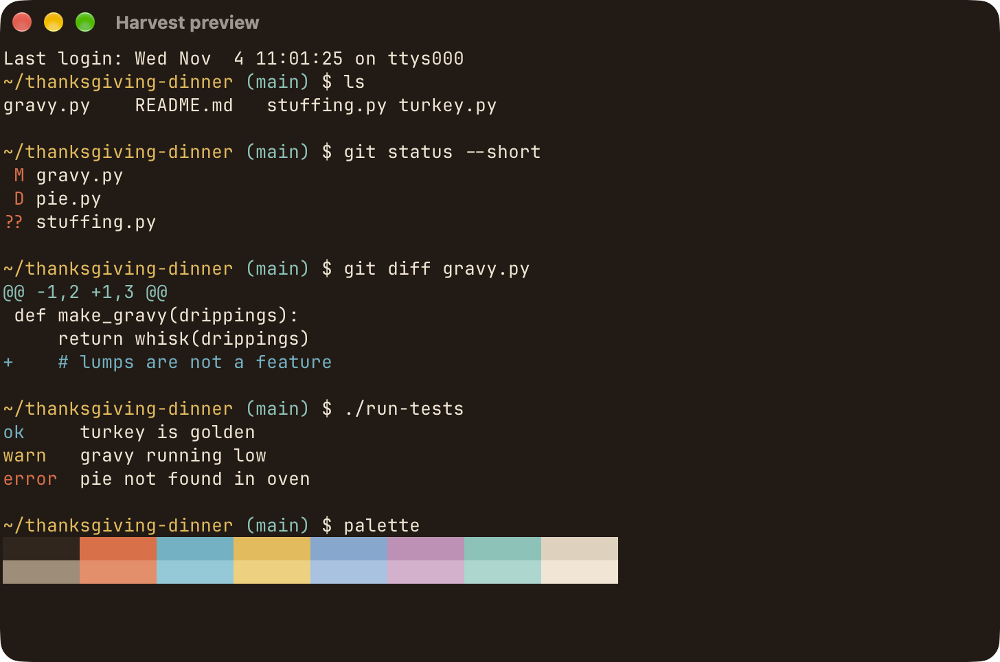
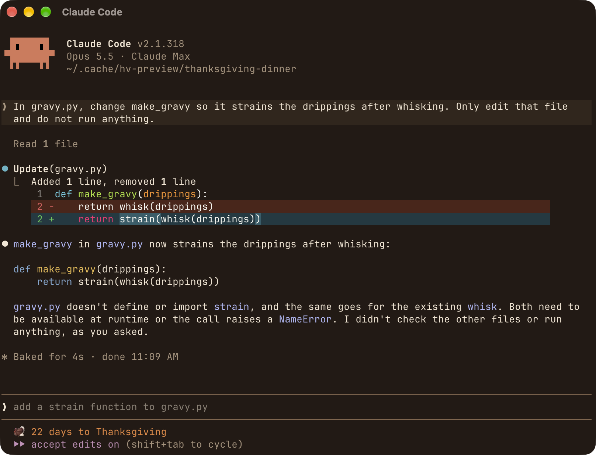
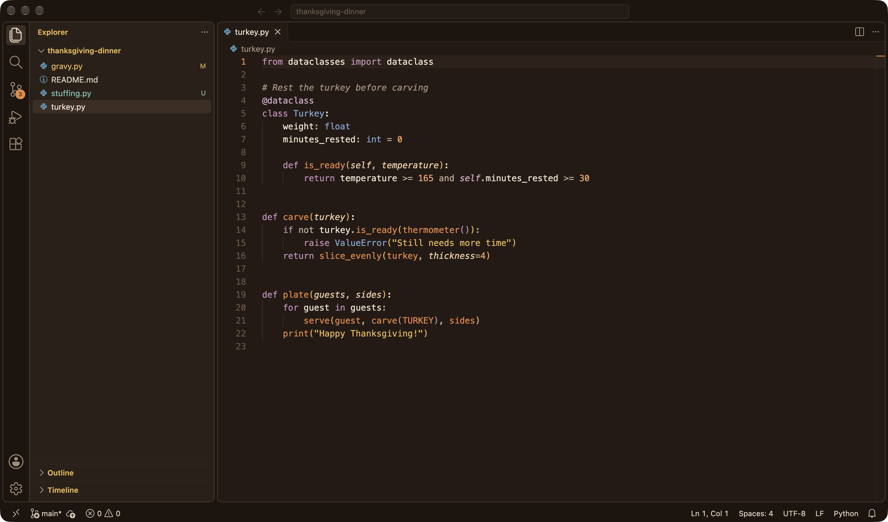
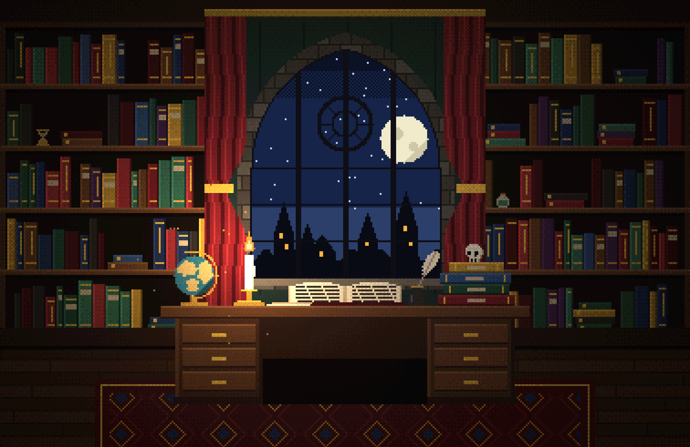
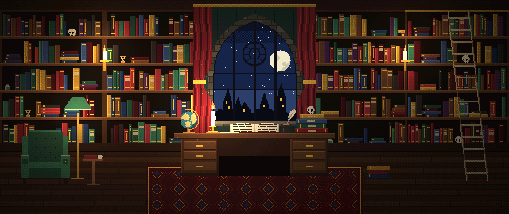

# Harvest

A cozy dark Thanksgiving theme for a macOS coding setup: Ghostty, VS Code, Claude Code, Slack and Chrome, plus a matching wallpaper.

## Screenshots

These are real screenshots of each app with Harvest on, using a small sample project.

### Ghostty



### Claude Code

Shows the theme, the Thanksgiving countdown and themed spinner verbs ("Baked for 4s"). Code inside diffs uses Claude Code's own syntax colors, which the theme doesn't change.



### VS Code



### Dark academia wallpapers

Separate from Harvest. See [Dark academia wallpapers](#dark-academia-wallpapers-1) below for how to regenerate them.

Laptop (3024 x 1964):



Ultrawide (2560 x 1080):



## Install

The script expects this repo at `~/.config/harvest-theme`, and it needs Python 3 and VS Code's `code` command.

```bash
git clone git@github.com:GregGlickert/harvest-theme.git ~/.config/harvest-theme
ln -s ~/.config/harvest-theme/harvest /opt/homebrew/bin/harvest
```

## Use

```bash
harvest on
harvest off
harvest status
```

`harvest on` switches Ghostty, VS Code and Claude Code, then prints the steps for Slack, Chrome, the wallpaper and the accent color, which are set by hand.

`harvest off` restores only what it changed, so other config edits are kept. Original values are saved in `state.json`, with config copies in `backup/`. Both stay on your machine and out of git.

## Layout

- `harvest`: on/off/status script
- `ghostty/Harvest`: Ghostty colors
- `vscode/`: VS Code theme source and packaged `.vsix`
- `claude/harvest.json`: Claude Code custom theme
- `statusline.sh`: Claude Code Thanksgiving countdown
- `chrome/harvest-theme/`: unpacked Chrome theme
- `slack-theme.txt`: Slack colors
- `wallpaper/`: wallpaper, its SVG and the script that generates it

## Dark academia wallpapers

`dark-academia/` holds a separate pixel art wallpaper of a candlelit library at night, in laptop (3024 x 1964) and ultrawide (2560 x 1080) sizes. `harvest` doesn't use it.

The script only needs Python 3 and writes the image to the current folder:

```bash
python3 make_dark_academia.py laptop
python3 make_dark_academia.py ultrawide
```
